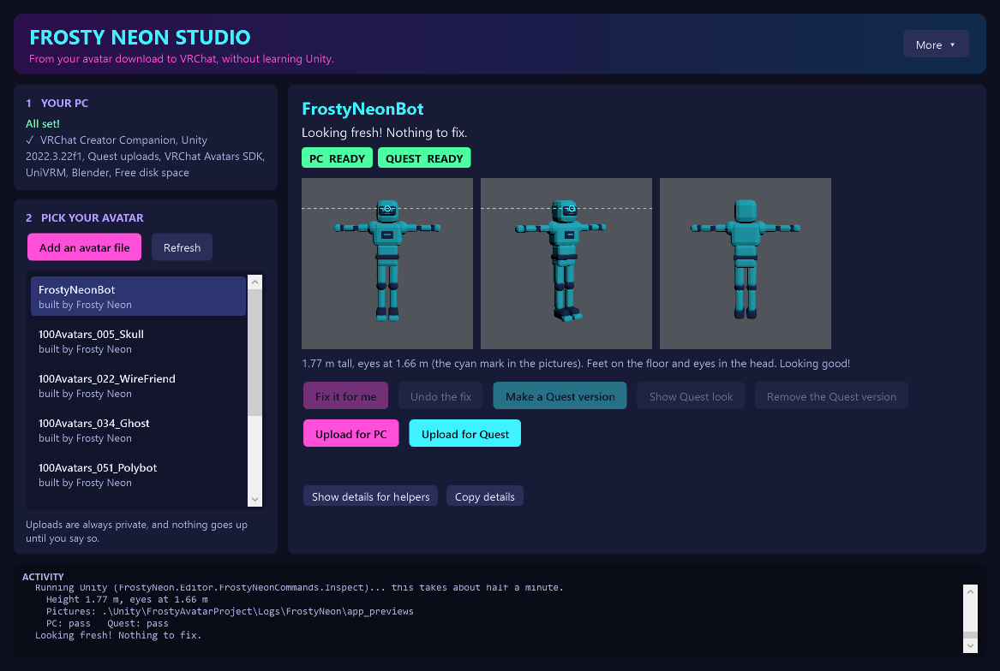

# Frosty Neon Studio

**Get your avatar into VRChat without learning Unity.**

Frosty Neon Studio is a Windows app for people who have an avatar but have never used Unity. Drop in a Booth package (`.unitypackage`), a VRoid Studio file (`.vrm`) or a model (`.fbx`). The app checks the avatar against VRChat's rules, explains what it finds in plain words, fixes what it safely can, makes a Quest version if you want one, and uploads it to your VRChat account as a private avatar.

**[Website](https://neonechodude.github.io/frosty-neon-studio/)** &middot; **[Download](https://github.com/NeonEchoDude/frosty-neon-studio/releases/latest)** &middot; **[Report a problem](https://github.com/NeonEchoDude/frosty-neon-studio/issues/new/choose)**
<!-- Discord link goes here once the server exists -->

Until the first release is published, download the code with the green **Code** button, then **Download ZIP**.

**Status: beta (0.1).** It works from start to finish on the avatars listed in [Tested with](docs/TEST_AVATARS.md), but it has not yet met many Booth avatars. If something looks wrong, please [report it](CONTRIBUTING.md#reporting-a-problem).

## What it does

- **Checks your PC.** It tells you what to install, in order: VRChat Creator Companion, the right Unity version, and Quest support. It installs nothing itself.
- **Brings your avatar in.** A Booth package is listed before it is imported, and if it contains scripts, the app shows them and asks first. A VRoid file's creator's terms are shown before anything happens. A plain `.fbx` model is set up as an avatar: rig, materials, eye position, and lip sync if the model has the mouth shapes.
- **Checks it the way VRChat does.** The check uses the VRChat SDK's own measurements and repeats the SDK's upload checks for the rig, size, meshes, textures and Quest shaders. Every finding says what it means for you in VRChat and whether you need to do anything.
- **Fix it for me.** Changes only the Unity import settings that VRChat's upload requires. Your avatar's own files are not edited, and you can undo it.
- **Make a Quest version.** Creates a separate copy with Quest materials and smaller Quest textures. Your PC avatar stays as it is, and both upload to the same avatar in VRChat.
- **Shows you pictures.** Front, three-quarter and back views, with your eye height marked, so you can see that you will stand on the floor and look out of your avatar's eyes.
- **Uploads it.** To your own account, always as a private avatar. Unity opens only for VRChat's sign-in and the final upload confirmation.

## Get started

1. **Install VRChat Creator Companion** from [vrchat.com/home/download](https://vrchat.com/home/download). It installs Unity and the VRChat SDK for you.
2. **Download Frosty Neon Studio** and unzip it to a folder with a short path, for example `C:\FrostyNeon`.
3. **Add the Unity project to Creator Companion.** Choose the `Unity\FrostyAvatarProject` folder inside the toolkit. Open it in Unity once so it can finish setting up, then close Unity.
4. **Double-click `Frosty Neon Studio.cmd`.** The app checks your PC and lists your avatars. Drop your avatar file on the window.

The full setup, with what you should see at each step, is in [START_HERE.md](START_HERE.md). Then follow [Your first avatar](docs/FIRST_AVATAR.md) from adding the file to wearing it in VRChat.

## Requirements

- Windows 10 or 11. The app uses Windows PowerShell and WPF, which are part of Windows.
- VRChat Creator Companion, which installs Unity 2022.3.22f1 and the VRChat Avatars SDK.
- A VRChat account that is allowed to upload avatars.
- For Quest: Unity's Android Build Support module.
- Optional: UniVRM for VRoid `.vrm` files (the app tells you how to add it), and Blender 5.2 for `.blend` files.

## Other ways to use it

- **Inside Unity:** the **Avatar Guide** window (**Frosty Neon > Avatar Guide (start here)**) walks through the same steps. See [Avatar Guide](docs/AVATAR_GUIDE.md).
- **From PowerShell:** every step is a `frosty.ps1` command, for example `doctor`, `import`, `vroid`, `model`, `fix`, `quest` and `upload`. Run `.\frosty.ps1 help`, or see [Commands](docs/AVATAR_PIPELINE.md).
- **From Blender:** `.\frosty.ps1 all <file.blend>` checks a Blender avatar, exports it with tested FBX settings and sets it up in Unity. See [Blender export profile](docs/FBX_EXPORT_PROFILE.md).

## Safety

- Nothing is uploaded until you confirm it in the upload box in Unity, and uploads are always private.
- Your avatar's own files (the FBX, the `.blend`, the creator's prefab) are never edited. Changes go into Unity's import settings and new files beside the originals. The Fix can be undone and the Quest version can be removed.
- A package that contains scripts is not imported until you agree, and you see which scripts they are first.
- A VRoid file's creator's terms are shown before it is set up, and again before upload if they limit who may use it.

## Known limits

- Tested on the included FrostyNeonBot, six free avatars from one collection, VRoid Studio sample exports, and generated test models. Few Booth avatars yet. See [Tested with](docs/TEST_AVATARS.md).
- Quest versions use VRChat's mobile shaders, so see-through and cut-out parts can look different from PC. A Quest version has been uploaded, but has not yet been checked on a Quest headset.
- VRoid files must be exported as **VRM 0.0**. VRM 1.0 is not supported yet.
- The check repeats only some of the VRChat SDK's upload checks. The SDK's own build has the final word.
- Windows only.

## Licence and credits

- The toolkit's code and documentation are under the [MIT licence](LICENSE).
- FrostyNeonBot, the starter avatar, is under [CC BY 4.0](Assets/Avatars/LICENSE-FrostyNeonBot.md). You may use it, change it and upload your own version. Please credit "FrostyNeonBot by NeonEchoDude".
- The VRChat SDK, Unity, UniVRM, Blender and Creator Companion are not part of this repository and have their own terms. When you add the project, Creator Companion installs the VRChat SDK and the community packages listed in `Unity/FrostyAvatarProject/Packages/vpm-manifest.json`.
- `Unity/FrostyAvatarProject/Packages/com.vrchat.core.vpm-resolver` is VRChat's package resolver. It is included the same way Creator Companion includes it in every project, under VRChat's own Distro licence (see its `License.md`).

Frosty Neon Studio is a fan-made tool. It is not made, endorsed or supported by VRChat Inc. "VRChat" is a trademark of VRChat Inc.
