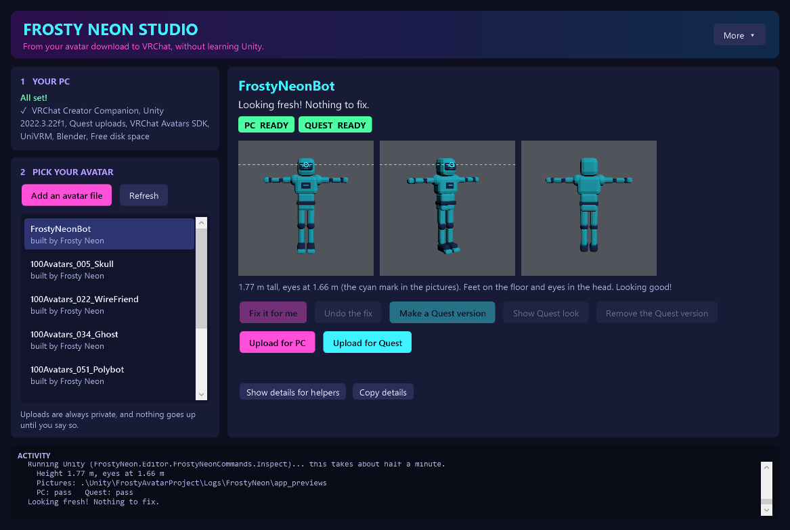

# Start here: set up Frosty Neon Studio

This page takes you from nothing installed to Frosty Neon Studio open and ready. Plan on about an hour the first time, most of it waiting for Unity to download. Nothing here costs money.

When you are done, continue with [Your first avatar](docs/FIRST_AVATAR.md).

## What you need

- A Windows 10 or 11 PC with at least 10 GB of free disk space.
- A VRChat account that is allowed to upload avatars. New accounts have to spend some time in VRChat before uploads are allowed. If yours cannot upload yet, VRChat's SDK tells you when you try.
- Your avatar file: a Booth package (`.unitypackage`), a VRoid Studio export (`.vrm`) or a model (`.fbx`).

## 1. Install VRChat Creator Companion

Creator Companion is VRChat's own installer for creator tools. It installs the Unity version VRChat needs (2022.3.22f1) and the VRChat SDK.

1. Download it from [vrchat.com/home/download](https://vrchat.com/home/download) and install it.
2. Start it once and let it finish its first-time setup. If it offers to install Unity 2022.3.22f1, say yes.

Do not install a newer Unity version for VRChat. VRChat avatars must be built with Unity 2022.3.22f1.

## 2. Download Frosty Neon Studio

1. Download the latest release, or use the green **Code** button and **Download ZIP**.
2. Unzip it to a folder with a short path, such as `C:\FrostyNeon`. Long paths, for example deep inside OneDrive, can cause Unity errors.

This folder is the toolkit folder. It contains `Frosty Neon Studio.cmd` and `frosty.ps1`.

## 3. Add the Unity project to Creator Companion

The toolkit includes a Unity project, `Unity\FrostyAvatarProject`. Creator Companion has to add the VRChat SDK to it.

1. In Creator Companion, go to **Projects** and choose **Add Existing Project**.
2. Pick the `Unity\FrostyAvatarProject` folder inside the toolkit folder.
3. If Creator Companion asks to install Unity 2022.3.22f1 or to add or update packages, say yes.
4. Click **Open Project**. The first start takes several minutes. Wait until the Unity window has finished loading, then close Unity.

## 4. Add Quest support (optional)

Skip this if you only use VRChat on PC.

Quest uploads need Unity's **Android Build Support**. In Unity Hub (install it from unity.com if Creator Companion did not), go to **Installs**, open the menu next to **2022.3.22f1**, choose **Add modules**, and tick **Android Build Support** with **OpenJDK** and **Android SDK & NDK Tools**.

## 5. Open Frosty Neon Studio

1. Make sure Unity is closed. The app runs Unity hidden in the background, and it cannot do that while the Unity Editor has the project open. Unity Hub and Creator Companion can stay open.
2. Double-click **`Frosty Neon Studio.cmd`** in the toolkit folder. To start it from your desktop next time, choose **More > Create a desktop shortcut** in the app.

The window opens. While the app works, the top-right corner shows the name of the step, how long it has been running, and a moving bar.

You should see:

- Under **1 YOUR PC**, either **All set!** or **Ready for PC avatars.**, followed by a list of what is installed.
  - **All set!** means everything is in place, including Quest support.
  - **Ready for PC avatars.** means something optional is missing, usually Quest support. The line below it says what.
  - **Install these first, in this order:** means something required is missing. Each missing item is listed with where to get it. Install it, then click **Check again**. Until then, the app does not look for avatars.
- Under **2 PICK YOUR AVATAR**, a list of the avatars already in the project. The first time, this is the starter avatar **FrostyNeonBot**. The list can take a minute to appear, because the app has to start Unity in the background.



You are set up. Next: [Your first avatar](docs/FIRST_AVATAR.md).

## If the app does not open

Open PowerShell in the toolkit folder and run this line. Any error appears in the PowerShell window.

```powershell
powershell -NoProfile -ExecutionPolicy Bypass -STA -File tools\app\FrostyNeonStudio.ps1
```

To see the full list of what is installed and what is missing without the app, run:

```powershell
.\frosty.ps1 doctor
```

It checks for Creator Companion, Unity 2022.3.22f1, Quest support, the VRChat SDK in the project, the lilToon and Poiyomi shaders, UniVRM, Blender and free disk space. It changes nothing.

If you are still stuck, see [Reporting a problem](CONTRIBUTING.md#reporting-a-problem).
