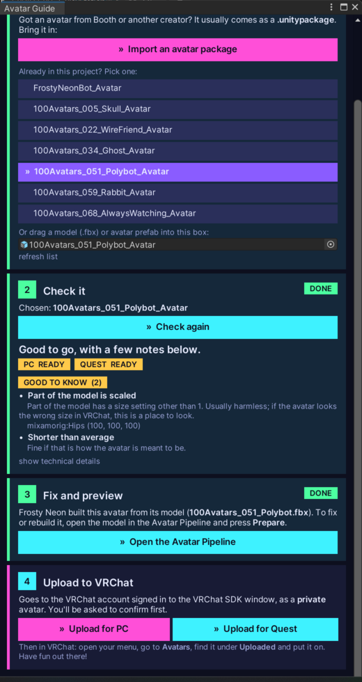

# Avatar Guide (inside Unity)

The Avatar Guide is a Unity window that walks through the same steps as Frosty Neon Studio: pick an avatar, check it, fix it, preview it, upload it. Use it if you prefer to work inside Unity, or if you want to see the avatar in the Unity scene while you work.

To open it, open the project from Creator Companion (**Open Project**), then choose **Frosty Neon > Avatar Guide (start here)** in Unity's menu bar.



The window has four step cards. Each one turns mint green with a **DONE** badge when its step is finished.

## Step 1: Pick your avatar

- **» Import an avatar package**: choose a `.unitypackage`, such as a Booth avatar. The Guide lists what is inside first: how many files, prefabs, models and shader files. If the package contains scripts (`.cs`, `.dll` and similar), it lists them and warns you, because Unity runs scripts as soon as they are imported. After the import, it picks the first avatar prefab the package brought in.
- **» Bring in a VRoid file (.vrm)**: choose a VRoid Studio export. See [VRoid files](#vroid-files) below.
- **Already in this project? Pick one**: a list of the avatar prefabs in the project.
- **Or drag a model (.fbx) or avatar prefab into this box**: the box accepts files that are already in the Unity project. To use an `.fbx` from elsewhere, drag it into Unity's **Project** window first, or add it with Frosty Neon Studio or `frosty.ps1 model`.

## Step 2: Check it

**» Check my avatar** runs the check and shows the result in plain words:

- one headline, such as "Looking fresh! Nothing to fix.", "Good to go, with a few notes below." or "Almost there! Let's sort out the bits below first.";
- a **PC** badge and a **Quest** badge;
- the findings in three groups:
  - **Must fix before uploading** (red): problems the toolkit cannot fix for you, each with what to do;
  - **Fixed for you by the Fix step** (cyan): what the Fix or the Avatar Pipeline's Prepare changes;
  - **Good to know** (amber): warnings that do not stop the upload.

Each finding has a title, what it means in VRChat, and where relevant, the objects involved. **show technical details** lists the original finding codes and messages. The codes are described in [Avatar preflight](AVATAR_PREFLIGHT.md#findings).

## Step 3: Fix and preview

What this step offers depends on the avatar.

**An avatar prefab** (ready-made from its creator, or already built by Frosty Neon): the step lists what the Fix would change and offers **» Fix it for me**. See [The Fix](#the-fix) below. If Quest refuses the avatar's materials, it also offers **» Make a Quest version**. See [Quest version](#quest-version).

**A plain model** (an `.fbx` with no avatar prefab yet): the step sends you to the **Avatar Pipeline** window (**» Open the Avatar Pipeline**), where **Prepare** sets the model up as an avatar. Then come back and check again. See [Commands and the Avatar Pipeline](AVATAR_PIPELINE.md).

**Preview.** **» Show me my avatar** takes front, three-quarter and back pictures of the avatar standing on the floor. A cyan dashed line and ring mark where your eyes will be in VRChat. The Guide also shows the height and eye height, and adds a note if the lowest point of the avatar is more than 3 cm below the floor (it may stand in the floor), more than 3 cm above it (it may float), or if the view is outside the upper half of the avatar. With a Quest version, **» Show the Quest look** shows that version.

The measurements come from the mesh in its rest pose, not from Unity's bounding boxes, which are padded.

## Step 4: Upload to VRChat

**» Upload for PC** and **» Upload for Quest** upload to the VRChat account signed in to the VRChat SDK window, always as a private avatar. Each asks you to confirm first. See [Uploading](AVATAR_UPLOAD.md).

- The step says whether Unity is set up for PC or Quest. Uploading for the other one switches Unity first, which takes a minute or two. Then press the button again.
- After a check, a button for a version that is not ready reads **PC: fix step 2 first** or **Quest: see step 3** instead.
- If the avatar has a Quest version, Quest uploads use it. Both versions go to the same avatar in VRChat.
- If the avatar came from a VRoid file whose terms say only the author may use it, the step says so in amber, and the upload asks you to confirm.

When an upload has finished, the step turns **DONE** and shows a short checklist for VRChat: find it under **Avatars > Uploaded**, check that your feet are on the floor, check in a mirror that your view is at the eyes and the mouth moves, and wave. **open the VRChat log folder** opens the folder with VRChat's newest `output_log` file.

## The Fix

Creators' avatars often trip VRChat's upload checks on three Unity import settings. The Fix changes only these, and only in Unity's import settings. The prefab, models, materials and textures are not edited.

| Finding | Setting changed |
|---|---|
| `mesh_read_write_disabled` | Model: **Read/Write** on |
| `sdk_legacy_blend_shape_normals` | Model: **Legacy Blendshape Normals** on |
| `sdk_texture_streaming_mipmaps` | Texture: **Streaming Mip Maps** on |

The Guide lists the planned changes, asks before making them, then checks the avatar again. Each change is recorded with its old value in `Logs/FrostyNeon/guided_fix_<avatar>.json`. **undo the Fix** puts every recorded setting back, even if you fixed the avatar in several goes.

Everything else stays with you, with the explanation from the check: missing shaders, Quest materials, and skeleton problems.

## Quest version

Most bought avatars use PC shaders, such as lilToon, Poiyomi or Unity's Standard shader. The VRChat SDK accepts only its own `VRChat/Mobile/...` shaders on Quest, so shaders are what usually stop a Quest upload. Quest avatars must also stay under 10 MB to download and 40 MB uncompressed.

When the check reports `sdk_quest_unsupported_shader` for an avatar prefab, step 3 offers **» Make a Quest version**. It creates, beside the creator's files and without changing them:

- `FrostyNeon_Quest/<avatar>_Quest.prefab`: a prefab variant of the avatar. It follows the creator's prefab and shares its VRChat avatar ID, so the PC and Quest uploads go to the same avatar.
- `FrostyNeon_Quest/Materials/`: a Quest material for each material Quest refuses, with the original's colour and main texture (including tiling). This works even when the original shader is not installed and the material shows pink. Materials Quest already accepts are kept.
- A 1024-pixel size limit for Quest only on the textures those materials use. PC texture sizes do not change. Each change is recorded with its old value in `Logs/FrostyNeon/quest_version_<avatar>.json`.

Which Quest shader each material gets:

- **Opaque** materials get `VRChat/Mobile/Toon Standard`.
- **Transparent** materials (MToon Transparent, or a render queue above 2500, such as eyelashes, eyeliner, brows, irises and eye highlights) get one of Quest's two see-through shaders: `VRChat/Mobile/Particles/Multiply`, or `VRChat/Mobile/Particles/Additive` for mostly bright textures such as highlights. Both use only the texture, not a colour.
- **Cut-out** materials (MToon Cutout, render queue 2450 to 2500) stay on Toon Standard and are listed, because no Quest shader can cut out. Their cut-away parts become solid. On VRoid clothing this shows as dark shapes at collars, cuffs and hems. Use **» Show the Quest look** to see it before uploading.

The Guide then checks the Quest version too. Step 2's Quest badge and step 4's Quest button use it, and step 3 lists anything still wrong for Quest, including a performance rank below the target, which means Quest players may see a fallback until they choose to show your avatar.

**rebuild it** makes the Quest version again, for example after the creator's prefab changed. **remove it** deletes the `FrostyNeon_Quest` folder and puts the texture settings back.

Before and after every upload, the two versions are given the same avatar ID. If only one has an ID, the other gets it. If they have different IDs, nothing is changed and the upload result says so.

## VRoid files

Unity needs **UniVRM**, a free add-on from the VRM project, to read `.vrm` files. If the project does not have it, the Guide explains where to download it (the [UniVRM releases page](https://github.com/vrm-c/UniVRM/releases)) and to add it with **» Import an avatar package**. Nothing is installed for you. Use the UniVRM package for **VRM 0.x**. The toolkit has been tested with UniVRM 0.131.4. `frosty.ps1 doctor` reports whether UniVRM is in the project.

**The creator's terms.** Every VRM file stores its creator's terms. Before anything is imported, the Guide reads them from the file: the VRM version, title, author, who may use it as an avatar, whether changes are allowed, commercial use, credit and licence.

- A **VRM 1.0** file is stopped at once with a message asking you to export as VRM 0.0.
- Terms that **prohibit changes** stop the set-up, because setting it up changes the avatar, unless you confirm with **I'm the author / I have permission**.
- Terms that allow **only the author** to use it as an avatar are checked when you **upload**. Avatars made from the file, and their Quest versions, are traced back to it, and the upload asks for the same confirmation.

**Set-up.** With UniVRM present, the file is copied into `Assets/FrostyNeon/VRoid`. UniVRM builds `<name>.prefab` from it, which can take up to two minutes. The Guide then makes `<name>_Avatar.prefab`, a VRChat avatar with the view position at the eyes and lip sync. A VRoid face has five vowel shapes rather than VRChat's 15 visemes, so lip sync uses the SDK's **Jaw Flap Blend Shape** mode with VRoid's `Fcl_MTH_A` shape as the mouth opening. From there the avatar goes through the same check, Fix, Quest version, preview and upload as any other.

## Missing shaders

Booth avatars usually need a shader package, such as lilToon or Poiyomi, that a new project does not have. Their materials then show pink. The check reports this as `material_shader_missing` and names the package when it can tell from the material's saved properties (lilToon, Poiyomi Toon Shader, Unity-Chan Toon Shader). Add the package through Creator Companion (**Manage Project**), or import the shader's own `.unitypackage`.

## The same from PowerShell

Every action in the Guide is also a `frosty.ps1` command, which runs with Unity closed:

```powershell
.\frosty.ps1 import  C:\Downloads\MyAvatar.unitypackage -DryRun   # list the contents only
.\frosty.ps1 import  C:\Downloads\MyAvatar.unitypackage           # import (refused if it contains scripts)
.\frosty.ps1 import  C:\Downloads\MyAvatar.unitypackage -AllowScripts
.\frosty.ps1 vroid   C:\Downloads\MyAvatar.vrm
.\frosty.ps1 fix     Assets/Shop/MyAvatar.prefab -DryRun          # list what the Fix would change
.\frosty.ps1 fix     Assets/Shop/MyAvatar.prefab                  # -Undo puts it back
.\frosty.ps1 quest   Assets/Shop/MyAvatar.prefab                  # -Remove deletes the Quest version
.\frosty.ps1 upload  Assets/Shop/MyAvatar.prefab                  # add -Quest for the Quest version
```

`Assets/Shop/MyAvatar.prefab` stands for the path of your avatar prefab inside the Unity project. `.\frosty.ps1 list` shows the paths. All commands are described in [Commands and the Avatar Pipeline](AVATAR_PIPELINE.md).

## For developers

- The window is `FrostyNeonGuide.cs`. The plain-language text for every finding is in `FindingText.cs`, and the self-test checks that every finding code the check can produce has text.
- The Fix is `AvatarGuidedFix.cs`, the Quest version `AvatarQuestVersion.cs`, package import `AvatarPackage.cs`, and VRoid files `AvatarVroid.cs`.
- `FrostyTheme.cs` holds the colours and styles: the neon banner, step cards, buttons and badges. It is original styling with no VRChat logos or artwork, and uses only characters the Unity editor font has.
- Self-tests, all part of `frosty.ps1 selftest`: `AvatarGuideSelfTest`, `AvatarGuidedFixSelfTest` and `AvatarQuestVersionSelfTest`.

## Tested

- Package import: listing a package's scripts without importing it, refusing it without `-AllowScripts`, and importing a package exported from a test avatar, which restored the avatar byte for byte. A package with 600 scripts (UniVRM) imported correctly, including Unity's script reload during the import.
- The Fix: on a test avatar with all three import problems, the Fix cleared them without changing the prefab, material, model or texture files, and Undo restored all three.
- Quest version: on test avatars, the Quest version passed the Quest check, kept the colours, textures and tiling, capped the texture for Quest only, and was removed cleanly. On VRoid's sample avatar P, the face of the Quest version matched the PC version.
- VRoid: VRoid's sample avatar P (VRM 0.0) and a `.vrm` exported from FrostyNeonBot were set up end to end. A VRM 1.0 sample was stopped with its terms shown.
- Preview: FrostyNeonBot and six test avatars measured within 2 cm of the floor, matching how they stand in VRChat.
- Not yet tested: a person clicking through every button of the window, and a real Booth avatar from start to finish. An upload started from the Guide uses the same uploader as the Avatar Pipeline window and `frosty.ps1 upload`, both of which have been used for real uploads.

See also [Tested with](TEST_AVATARS.md).
