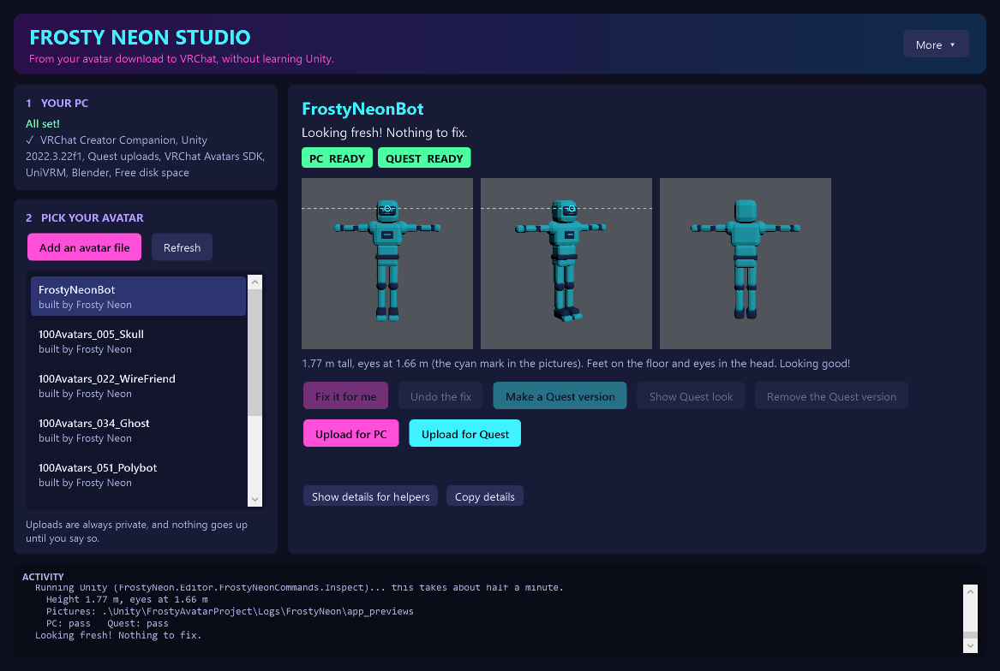

# Frosty Neon Studio (the app)

Frosty Neon Studio is the toolkit's Windows app. It does everything without opening Unity, except the upload itself, where VRChat's sign-in and upload confirmation happen inside Unity. Start it by double-clicking **`Frosty Neon Studio.cmd`** in the toolkit folder, or create a desktop shortcut from the **More** menu.

For a walkthrough, see [Your first avatar](FIRST_AVATAR.md). This page describes each part of the window and what happens behind it.



## The window

### 1 YOUR PC

Shows whether this PC has what the toolkit needs. It runs `frosty.ps1 doctor` when the app starts.

- **All set!**: everything is installed.
- **Ready for PC avatars.**: something optional is missing, such as Quest support or free disk space. The lines below say what and how to add it.
- **Install these first, in this order:** something required is missing. Each missing item is listed with where to get it. Install it, then click **Check again**.

The last line lists what is installed. If Unity has the project open, the card says so. Until nothing required is missing, the app does not look for avatars, and the right side says **First, set up your PC**. See [Commands](AVATAR_PIPELINE.md#doctor) for everything `doctor` checks.

### 2 PICK YOUR AVATAR

Lists the avatars in the Unity project, each with its kind: **ready-made** (for example from a Booth package), **VRoid**, or **built by Frosty Neon** (set up from a plain model). An avatar that has a Quest version says so. The app comes back to the avatar you picked last time.

- **Add an avatar file** opens a file picker. You can also drop a file anywhere on the window. While you drag a file over the window, it says what dropping it will do.
- **Refresh** looks for avatars in the project again.

Accepted files:

| File | Command it runs | Notes |
|---|---|---|
| `.unitypackage` | `frosty.ps1 import` | A package with scripts is refused at first. The app lists the scripts and asks (**Import it** or **Don't import**); if you agree, it imports again with `-AllowScripts`. |
| `.vrm` | `frosty.ps1 vroid` | If the creator's terms limit use or changes, the app shows them and asks (**Yes, I may use it**); if you agree, it runs again with `-AcceptTerms`. Needs UniVRM in the project and a VRM 0.0 file. |
| `.fbx` | `frosty.ps1 model` | Asks first (**Set it up**). The copy goes to `Assets/FrostyNeon/Models/<name>/`, with a `<name>.fbm` or `Textures` folder beside it if the original has one. |
| `.zip` | none | Lists the avatar files inside without unpacking, and asks you to unzip first. |
| `.blend` | none | Explains how to export as FBX. |

After an avatar is added, the list refreshes and the new avatar is selected.

### The avatar panel

Until you pick an avatar, the right side says what to do next. Once you pick one, the app runs `frosty.ps1 inspect` and shows:

- the name and a one-line headline;
- the **PC** and **QUEST** badges (**READY** or **NEEDS WORK**). The second badge reads **QUEST VERSION** when the avatar has one;
- the creator's terms, when they say only the author may use the avatar;
- front, three-quarter and back pictures, with the VRChat eye position marked in cyan;
- the height, the eye height, and any floor or view notes;
- the findings in three groups (**Must fix before uploading**, **Fixed for you by the Fix step**, **Good to know**), what the Fix would change, the Quest version and its notes, and the last upload;
- **Show details for helpers**, which opens the technical side: the app version, the finding codes, the objects they concern, and where the reports and logs are. **Copy details** copies these details and the last 80 lines of the activity log, ready to paste into a message to a helper. Your Windows user name and the toolkit folder are left out of the copy.

### Buttons

Each button is available only when it applies. Hover over a greyed-out button to see why it is off. Alt and the underlined letter press a button from the keyboard.

| Button | Available when | Runs |
|---|---|---|
| **Fix it for me** | The check found import settings the Fix can change | `frosty.ps1 fix <prefab>` |
| **Undo the fix** | The Fix has changed this avatar | `frosty.ps1 fix <prefab> -Undo` |
| **Make a Quest version** | Quest refuses the avatar's materials | `frosty.ps1 quest <prefab>` |
| **Make the Quest version again** | (same button) the avatar has a Quest version | `frosty.ps1 quest <prefab>` |
| **Show Quest look** / **Show PC look** | The Quest version has pictures | Switches the pictures; runs nothing |
| **Remove the Quest version** | The avatar has a Quest version | `frosty.ps1 quest <prefab> -Remove` |
| **Upload for PC** | The PC check passes | `frosty.ps1 upload <prefab>` |
| **Upload for Quest** | The Quest check passes and Unity's Android Build Support is installed | `frosty.ps1 upload <prefab> -Quest` |

Every button that changes something asks first. What each command does is described in [Commands](AVATAR_PIPELINE.md), the [Avatar Guide](AVATAR_GUIDE.md) (Fix and Quest version) and [Uploading](AVATAR_UPLOAD.md).

### The More menu

- **Create a desktop shortcut**: a shortcut that starts the app without a console window.
- **Copy details for a helper**: the same as **Copy details** under the avatar's results.
- **Open the logs folder**: opens `Unity\FrostyAvatarProject\Logs\FrostyNeon\`.
- **Check this PC again**: runs `doctor` again.

### Messages, activity and the busy bar

When something goes wrong, a red notice appears at the top of the window. It says what happened and what to do, usually with a **Try again** or **Check this PC again** button. **Dismiss** hides it.

The app runs one step at a time. While it works, the top-right corner shows the step, the time it has taken and a moving bar. After about half a minute it adds a note that Unity is working, since starting Unity in the background takes a while each time.

The output of each step scrolls in the **ACTIVITY** log at the bottom of the window.

## Good to know

- **Unity must be closed.** Every step except the upload runs Unity hidden in batch mode, which cannot share the project with an open Unity Editor. If the Editor is open, the notice says so; close Unity, then click **Try again**.
- **Uploads open Unity.** Close Unity before you upload. Unity opens, signs in with the account saved in the VRChat SDK window, and shows a confirmation box. Nothing is uploaded until you click **Upload** or **Update** there. Unity stays open afterwards; close it when you are done, then click **Try again** in the app to refresh the avatar's check.
- **Closing during a step.** The step is not stopped, because stopping Unity halfway could damage the project. It finishes in the background, and the result shows the next time you open the app. An upload in progress continues in the Unity window.
- **The app remembers** the last avatar and the window's size and place.
- **Nothing installs.** The app uses Windows PowerShell 5.1 and WPF, which come with Windows.

## Files

Everything the app reads and writes is in `Unity\FrostyAvatarProject\Logs\FrostyNeon\`. This folder is not kept in Git.

| File | Written by |
|---|---|
| `doctor.json` | `doctor` |
| `list_result.json` | `list` |
| `inspect_result.json`, `app_previews/` | `inspect` (the report and the pictures) |
| `package_import.json` | `import` |
| `vroid_result.json` | `vroid` |
| `pipeline_<name>.json` | `model` |
| `fix_result.json`, `quest_result.json` | `fix`, `quest` |
| `upload_result.json` | the uploader in Unity |
| `studio.json` | the app (the last avatar, the window's size and place) |

## For developers

The app is `tools/app/FrostyNeonStudio.ps1` with its layout in `tools/app/FrostyNeonStudio.xaml`, and uses `brand/icon.ico` when it is present. It starts `frosty.ps1` as a hidden child process in the Unity project folder and reads the JSON reports above. The script must stay plain ASCII, because Windows PowerShell 5.1 reads a script without a byte-order mark as ANSI; write other characters as `[char]` codes. The XAML file is read as UTF-8.

To start it from PowerShell, with errors shown in the console:

```powershell
powershell -NoProfile -ExecutionPolicy Bypass -STA -File tools\app\FrostyNeonStudio.ps1
```

Test options:

| Option | What it does |
|---|---|
| `-SelfTest` | Loads the window, fills it from sample reports, checks it, and exits with 0 for pass or 1 for fail. Needs no Unity. Also part of `frosty.ps1 selftest`. Add `-Screenshot <file.png>` to save pictures of several states beside that file (filled, drop highlight, empty, setup notice, minimum size, dialog). |
| `-Screenshot <file.png> [-Select <prefab>]` | Starts normally, optionally selects an avatar, saves a picture of the window once it is idle, and closes. |
| `-Screenshot <file.png> -Add <file> -Yes` | Adds the file as if it had been dropped, answers Yes to the app's own questions, and writes its messages to the log. Uploads are refused in this mode. |

## Tested

- The self-test (45 checks) covers every part of the window filled from sample reports, the button rules and their tooltips, the setup card, the notice bar, file kinds, reading a zip without unpacking it, the drop highlight, the elapsed-time label, file names with unusual characters, the desktop shortcut, and remembering the last avatar and window place.
- Earlier versions of the app were run for real: selecting FrostyNeonBot with its pictures, badges and upload history, and adding a plain `.fbx` with a `Textures` folder through `-Add -Yes`, from copying to selecting the new avatar.
- Not yet tested by hand with the current version: a full run with real avatars, importing Booth packages, the VRoid dialogs, an upload from start to finish, closing during a step, Windows display scaling above 100%, and keyboard-only use. Each button runs a `frosty.ps1` command that has been tested from PowerShell.
